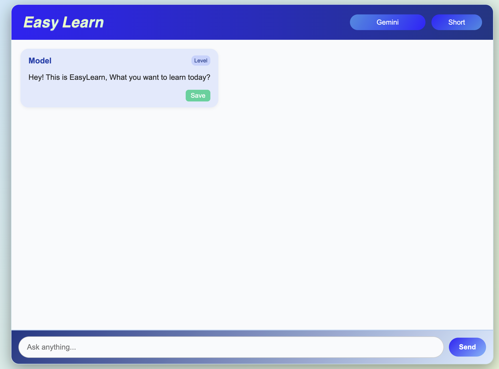
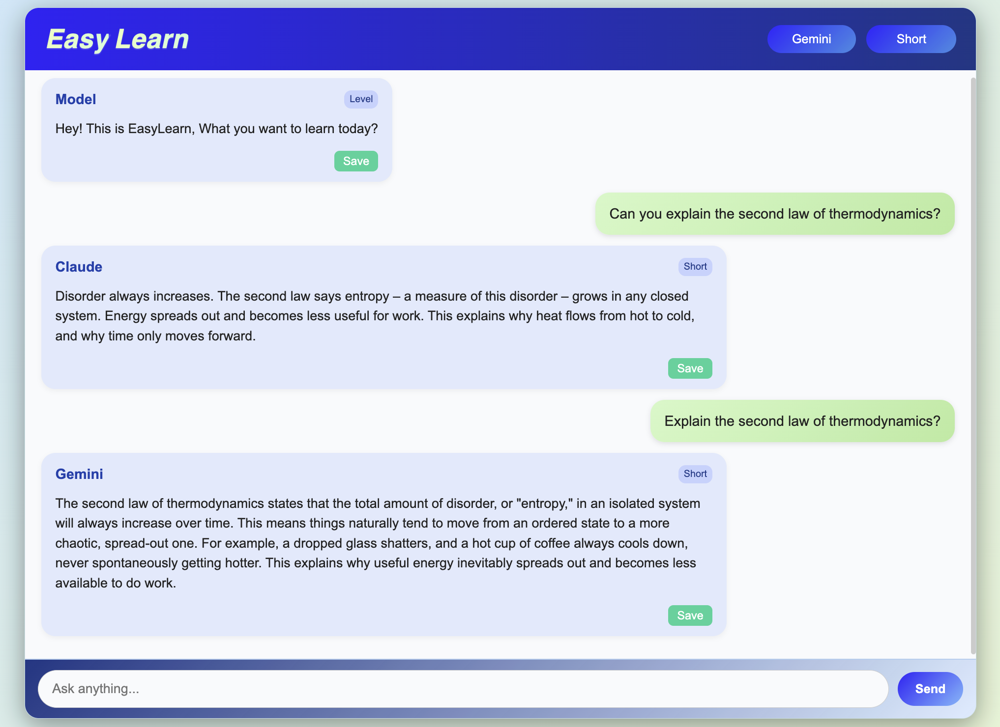
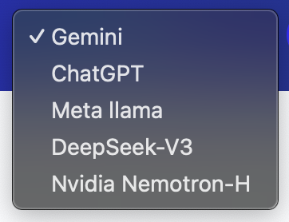

# EasyLearn

EasyLearn is a browser-based learning app that explains a concept at three
depths. It runs a small language model on the learner’s device, and can save a
lesson as a Markdown file to the learner’s Google Drive.

## Learning modes

- **Quick** gives the core idea in a few sentences.
- **Guided** builds a clear explanation step by step.
- **Deep dive** adds more detail, an example, and a self-check.

## How it works

The React frontend runs [WebLLM](https://github.com/mlc-ai/web-llm) in a Web
Worker and uses WebGPU for local generation. The available models are Llama 3.2
1B, Gemma 2 2B, and Llama 3.2 3B. The selected model downloads in the browser
the first time it is used and is cached for later sessions. WebGPU support and
generation speed depend on the browser and device.

The FastAPI backend handles Google sign-in and the EasyLearn session only. It
does not receive learning prompts or answers for inference, and it does not
store user profiles or learning history. When a learner chooses **Save to
Drive**, the browser requests Google Drive access with the `drive.file` scope
and uploads that lesson as a Markdown file to an `EasyLearn` folder. The Drive
access token stays in browser memory.

## Run locally

You need Python 3.10 or newer, Node.js, and a browser/device with WebGPU for
local model inference.

### 1. Configure environment files

Copy the examples:

```sh
cp Backend/.env.example Backend/.env
cp Frontend/my-app/.env.example Frontend/my-app/.env.local
```

Set the same Google OAuth **Web application** client ID in both files. In
`Backend/.env`, set `AUTH_SESSION_SECRET` to a random value of at least 32
characters. For local HTTP development, set `AUTH_COOKIE_SECURE=false` in
`Backend/.env`; keep it `true` in HTTPS deployments. The frontend API URL
defaults to `http://localhost:8000`.

To enable Drive saves, enable the Google Drive API in the OAuth client’s Google
Cloud project and add `http://localhost:5173` to its authorized JavaScript
origins. Add your deployed frontend origin there for production. Keep
`CORS_ORIGINS` in the backend environment set to the exact frontend origin(s).
While the OAuth app is in testing, add your Google account as a test user.

### 2. Start the backend

```sh
cd Backend
python3 -m venv .venv
source .venv/bin/activate
pip install -r requirements.txt
uvicorn main:app --reload --port 8000
```

### 3. Start the frontend

In another terminal:

```sh
cd Frontend/my-app
npm install
npm run dev
```

Open the local URL printed by Vite (usually `http://localhost:5173`). Choose a
model, wait for its first download, then ask a question. Google sign-in is
optional; sign in and authorize Drive when you want to save a lesson there.

## Environment variables

| Variable | Where | Purpose |
| --- | --- | --- |
| `VITE_API_BASE_URL` | Frontend | Backend base URL; local default is `http://localhost:8000`. |
| `VITE_GOOGLE_CLIENT_ID` | Frontend | Google OAuth Web client ID used by Google Identity Services. |
| `GOOGLE_CLIENT_ID` | Backend | The same client ID, used to verify sign-in credentials. |
| `AUTH_SESSION_SECRET` | Backend | Random secret of at least 32 characters for signing the session cookie. |
| `AUTH_COOKIE_SECURE` | Backend | `true` for HTTPS; use `false` only for local HTTP development. |
| `AUTH_COOKIE_SAMESITE` | Backend | Session cookie policy; default is `lax`. |
| `CORS_ORIGINS` | Backend | Comma-separated, exact frontend origins allowed to call the API. |

Keep `.env` and `.env.local` files private. Do not commit real credentials or
secrets. In deployment, configure these variables in the frontend and backend
hosting providers, use HTTPS, set the production frontend origin in
`CORS_ORIGINS`, and keep `AUTH_COOKIE_SECURE=true`.

## Privacy and data

- Questions and answers are held in page memory and processed by the local
  model. They are not sent to EasyLearn’s backend or a hosted model API for
  inference.
- The app keeps theme preference and model-usage metadata in browser
  `localStorage`; this metadata does not include question or answer text.
- Google receives sign-in and Drive requests. A sign-in credential is sent to
  the backend for verification. A lesson is sent to Drive only after the
  learner chooses **Save to Drive**.
- Model files, Google sign-in assets, and fonts are fetched from their
  respective providers. Those requests can reveal ordinary connection details
  such as IP address and requested resources.
- EasyLearn does not include analytics or advertising event calls in the app
  code. Hosting providers may keep their own request logs.

For the in-app details, open **Privacy and Data** from the profile menu.

## Project structure

```text
Backend/                 FastAPI authentication/session service
Frontend/my-app/         React + Vite application
Frontend/my-app/src/Home/ Learning UI, local model runtime, and worker
```

## Screenshots






